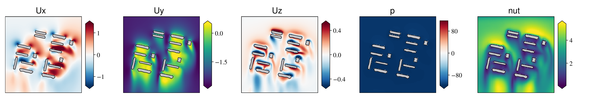
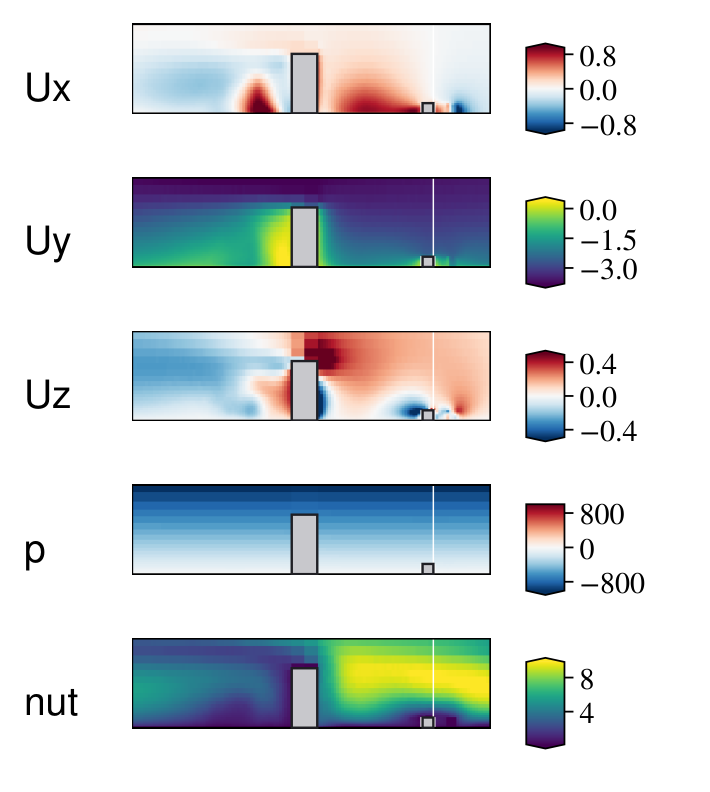
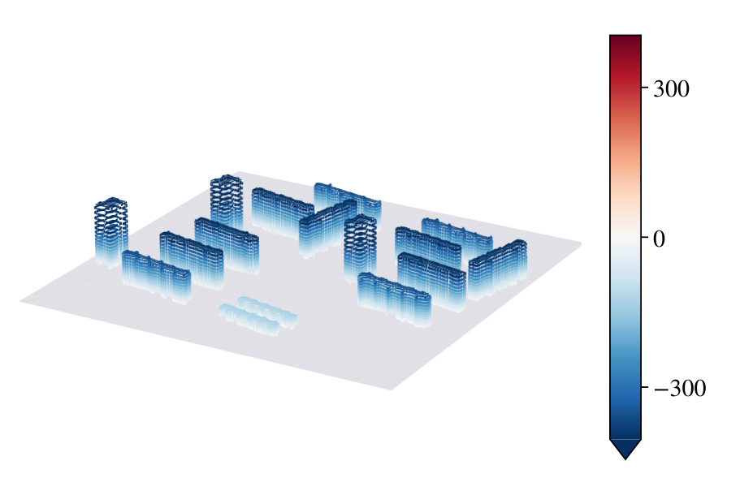

# IBO on UrbanWind

Code for the UrbanWind experiments of **"Seeing Near and Far: A Neural
Operator That Efficiently Tokenizes and Decodes on Industrial-Scale CFD
Meshes"** (ICLR 2027 submission). It contains:

- the **Importance-Balanced Operator (IBO)**: model, preprocessing,
  training and evaluation;
- the baselines we reproduced on UrbanWind under the same protocol:
  AB-UPT, Transolver-3, SpiderSolver and Erwin;
- `predict_new_case.py`, which predicts the wind field around a new estate
  from its building footprints and heights, using the trained weights, or
  at the points of a CFD case and scores the prediction against it;
- `npz_to_raw.py`, which turns CFD cases in the dataset's NPZ format into
  the raw case files the preprocessing reads, for training on new cases or
  for scoring the model on them.

The repository has two audiences. [Research](#research) covers the method,
the results and how the experiments run. [Using the trained
model](#using-the-trained-model) covers installation, the weights folder,
the input format for a new estate, and what the code does and does not do.



*IBO prediction for UrbanWind estate 0562b016 (16 buildings, northerly
wind) on a horizontal slice: the three velocity components (m/s), the
kinematic pressure and the turbulent viscosity. Building cross-sections in
grey. More panels in [`Demo/`](Demo).*

---

## Research

### Method

A CFD case is a set of mesh points, often millions of them. IBO represents
it with L latent points. It encodes the mesh locally into one token per
latent point, processes the tokens globally, and decodes every query point
from its nearest tokens. The paper argues that how the latent points are
placed matters. IBO places them with a KD-tree whose leaves carry equal
importance mass, so latent points are dense where the flow is hard to
reconstruct and sparse elsewhere.

On UrbanWind:

- **Latent layout.** Volume points are split by a weighted-median KD-tree
  of 14 levels, giving L = 16,384 leaves. Each point carries the weight
  w = max(s, 2 m)^(-1/2), where s is its distance to the nearest building
  face, and every leaf receives the same total weight. Each latent point
  sits at the weighted centroid of its leaf. This step has no learned
  parameters and runs once per case.
- **Local encoder.** A shared PointNet (13 → 64 → 256) reads 32 member
  slots per leaf. Surface points fill the slots first, then uniformly drawn
  volume points. The channelwise max, mean and standard deviation of its
  outputs are concatenated with 19 leaf statistics and the latent position,
  and a linear layer projects them to a token of width 384.
- **Global processor.** Twelve pre-norm Transformer blocks run full
  attention over the 16,384 tokens, with 12 heads of width 32 and 3D rotary
  embeddings. Adaptive layer norm conditions every block on five
  morphology scalars: log building count, total footprint area, frontal
  area facing the wind, mean building height and maximum building height.
- **Local decoder.** Each query point reads its k = 8 nearest latent
  points by local cross-attention (width 192, 6 heads) with a distance
  prior. Separate heads produce the volume and surface outputs. The cost
  per point does not depend on L; full-field inference averages 12 TFLOP
  per case.
- **Inputs and targets.** Each point carries its position (divided by
  550 m), the signed distance and direction to the nearest building face,
  six axis-aligned ray distances to the buildings (capped at 550 m) and
  categorical region codes. Buildings are 2.5D: footprint polygons
  extruded to their height. The volume targets are U<sub>x</sub>,
  U<sub>y</sub>, U<sub>z</sub>, p and ν<sub>t</sub>, and the surface target
  is p<sub>s</sub>. Before z-scoring, U<sub>y</sub> has
  −0.4494 · ln max(z, 0.1 m) subtracted and the pressures have 9.81 z
  added. Both terms are restored after prediction. All constants live in
  `norm_stats.json`.

The full description is in Section 5 and Appendices C and D of the
paper.
The main-table setting is the default in [`config.yaml`](config.yaml).

### UrbanWind

UrbanWind holds steady RANS simulations (OpenFOAM) of atmospheric
boundary-layer flow over residential estates of 1 to 124 buildings, with
four wind directions per estate. Learning uses the central
1,100 m × 1,100 m × 160 m region, about 3 × 10<sup>6</sup> points per
case, in a frame where the wind blows toward −y. The benchmark has 400
training estates, 40 validation estates and 40 test estates, each with four
directions: 1,600 / 160 / 160 cases. The dataset is not distributed with
this repository.

### Results

Relative L<sub>2</sub> error in physical units on the 160 test cases, and
the cost of one full-field prediction (latency on one A100):

| Model | U<sub>x</sub> | U<sub>y</sub> | U<sub>z</sub> | p | ν<sub>t</sub> | p<sub>s</sub> | Latency (s) | TFLOP |
|---|---|---|---|---|---|---|---|---|
| SpiderSolver | 0.9145 | 0.1571 | 0.8192 | 0.0073 | 0.1886 | 0.0081 | 19.697 | 37.12 |
| Erwin | 0.6359 | 0.1246 | 0.6093 | 0.0146 | 0.3767 | 0.0256 | 15.538 | 29.85 |
| Transolver-3 | 0.5811 | 0.0954 | 0.5678 | 0.0070 | 0.1263 | 0.0096 | 1.771 | 75.70 |
| AB-UPT | 0.1365 | 0.0222 | 0.1448 | 0.0006 | 0.0427 | **0.0012** | 3.246 | 479.50 |
| **IBO** | **0.1267** | **0.0199** | **0.1335** | **0.0004** | **0.0337** | 0.0023 | **0.364** | **12.14** |

IBO and AB-UPT are means over three training seeds (42, 1042, 2042); the
other rows are single runs.

The layout ablation keeps the model and the token budget fixed and changes
only where the latent points go:

| Latent layout | U<sub>x</sub> | U<sub>y</sub> | U<sub>z</sub> | p | ν<sub>t</sub> | p<sub>s</sub> | `--model` |
|---|---|---|---|---|---|---|---|
| Uniform grid (32 × 32 × 16) | 0.1785 | 0.0272 | 0.1868 | 0.0007 | 0.0410 | 0.0029 | `ibo_grid` |
| Adaptive, equal count | 0.1429 | 0.0222 | 0.1498 | 0.0005 | 0.0360 | 0.0027 | `ibo_equal` |
| Adaptive, importance-weighted (IBO) | **0.1267** | **0.0199** | **0.1335** | **0.0004** | **0.0337** | **0.0023** | `ibo` |

| Vertical slice | Building-surface pressure |
|---|---|
|  |  |

### Running the experiments

All commands go through `main.py`. Four GPUs with one case per GPU is the
paper's setting for every model.

**Raw data.** One file per case, `<estate>_<dir>.pt` with dir in N, E, S, W,
already cropped to the learning region and rotated into that direction's
wind frame. Keys: `volume_pos`, `volume_fields` (U<sub>x</sub>,
U<sub>y</sub>, U<sub>z</sub>, p, ν<sub>t</sub>), `surface_pos`,
`surface_fields` (p and the three wall-shear components; only p is used),
`surface_normals`, `volume_sdf` and `volume_sdf_grad` (distance to the
CFD geometry and its gradient). Set `data.raw_pt_dir` in `config.yaml` or
pass `--raw-dir`. `npz_to_raw.py` produces these files from CFD cases in
the dataset's NPZ format ([Preprocessing your own
cases](#preprocessing-your-own-cases)).

**Preprocessing** turns the raw cases into one pack per estate:

```bash
python main.py preprocess --norm-stats path/to/norm_stats.json
```

- Pass 1 extracts each estate's building footprints from its surface
  points: DBSCAN clusters, concave hulls, simplification.
- A filter drops non-finite and anomalous cases. The anomaly part compares
  statistics over every case in the folder; with fewer than a few hundred
  cases pass `--no-anomaly-filter`.
- Pass 2 computes the per-point features of the Method section and the
  latent layout.

The normalization file is an input. Training and evaluation read the copy
written into the cache. Packs go to
`work/cache_estate/L16384_idw16_pn32_invsqrt_sf_v1/`. The ablation layouts
reuse every per-point field and only rebuild the partition:

```bash
python main.py releaf --source work/cache_estate/L16384_idw16_pn32_invsqrt_sf_v1 --grid equal
python main.py releaf --source work/cache_estate/L16384_idw16_pn32_invsqrt_sf_v1 --grid structured
```

**Splits** are pool manifests (`src/manifest.py`), json files that name the
training and test estates and assign training estates to GPUs. They are
not part of this repository. `python main.py manifest {rebuild |
repartition | verify | retest}` maintains them.

**Training** (4 GPUs):

```bash
torchrun --standalone --nproc_per_node 4 main.py train --model ibo --manifest work/manifest_400.json --auto-resume
```

- `--model` is one of `ibo`, `ibo_equal`, `ibo_grid`, `abupt`,
  `transolver`, `spider`, `erwin`.
- Each baseline keeps its own architecture and optimizer settings from
  `src/recipes/` and the matching section of `config.yaml`.
- SpiderSolver needs its partitions once:
  `python main.py derive --model spider --manifest work/manifest_400.json`.

A run trains for 400 epochs and averages the weights of the last quarter
(SWA). It ends with three files in its run directory:

- `swa_model.pt`
- `config_used.yaml`
- `training_log.jsonl`

`--auto-resume` continues an interrupted run, and `--max-hours` stops
cleanly at an epoch boundary. `--seed` with `--replicate-of` trains
another seed of an existing run.

**Evaluation** rebuilds the model from the run's own `config_used.yaml`:

```bash
torchrun --standalone --nproc_per_node 4 main.py post --run-dir work/runs/m400_ibo
```

It writes:

- the predictions of every test point;
- per-case metrics;
- latency, memory and FLOP telemetry;
- `table.tex`, the run's row of the results table.

**Tools**

- `tools/wall_distance_bins.py` gives errors in near/mid/far wall-distance
  thirds (paper Appendix D).
- `tools/time_inference.py` gives a stage-by-stage latency breakdown on one
  GPU.
- `tests/` holds the numerical equivalence tests, run with
  `python -m pytest tests` (needs `pip install pytest`).

---

## Using the trained model

### Installation

Python 3.10 or newer. Install PyTorch (2.4 or newer) for your platform and
CUDA version first, following [pytorch.org](https://pytorch.org/get-started/locally/).
Then install the rest:

```bash
pip install -r requirements.txt
```

Inference uses a CUDA GPU when one is available and the CPU otherwise.

### The weights folder

The weights are not in this repository. Put the three files of the trained
model in one folder:

```
weights/
  swa_model.pt       # the trained IBO weights
  config_used.yaml   # the configuration the model is rebuilt from
  norm_stats.json    # normalization and detrending constants
```

The code reads everything from these files. The model architecture and the
preprocessing settings come from `config_used.yaml`, and no other
configuration is needed.

### Predicting a new estate

```bash
python predict_new_case.py --geometry examples/toy_estate.json --weights path/to/weights --out outputs
```

**Input.** A JSON file of 2.5D buildings, each a footprint polygon extruded
from the ground to its height:

```json
{
  "name": "toy_estate",
  "buildings": [
    {"footprint": [[-260, 120], [-170, 120], [-170, 136], [-260, 136]], "height": 48},
    {"footprint": [[20, 130], [48, 130], [48, 158], [20, 158]], "height": 58}
  ]
}
```

- Units are metres.
- Origin at the centre of the 1,100 m × 1,100 m output domain, ground at
  z = 0.
- **The wind blows toward −y.** With +y pointing north, this is a
  northerly wind.
- Footprints are simple polygons in any vertex order; holes are ignored.
- Buildings may extend past the domain edge and are cut there.

[`examples/toy_estate.json`](examples/toy_estate.json) is a complete
example with 12 buildings.

**Other wind directions.** Rotate the geometry so that the wind blows
toward −y. If the wind blows toward the angle θ (counter-clockwise from
+x), rotate every vertex about the origin by φ = −90° − θ. The predicted
vectors are then in the rotated frame; rotate them back by −φ.

**Output.** Written to `--out`:

| File | Contents |
|---|---|
| `<name>.npz` | `volume_pos` [N, 3] (m)<br>`volume_fields` [N, 5]: U<sub>x</sub>, U<sub>y</sub>, U<sub>z</sub>, p, ν<sub>t</sub><br>`surface_pos` [M, 3]<br>`surface_normal` [M, 3]<br>`surface_fields` [M, 1]: p<sub>s</sub><br>`surface_building` [M]<br>the reference height and z layers of the point set |
| `<name>_volume.vtk` | Volume points with U, p and nut (legacy VTK, opens in ParaView) |
| `<name>_surface.vtk` | Building-surface points with p and the normals |

Units are those of the training data:

- velocity in m/s;
- p is kinematic pressure (m²/s²) and contains a hydrostatic component
  linear in height;
- ν<sub>t</sub> in m²/s.

**What the script does.** It needs no dataset and no cache:

1. **Point set.** It places points at the vertices of the UrbanWind CFD
   mesh:
   - The reference height H is the tallest building rounded up to 10 m.
   - The z layers come from the blockMesh rule: top 6H, layers graded
     50:1, first layer about 1 m. The points lie on the layer boundaries,
     the ground plane z = 0 included.
   - Horizontal cells are 3.125 m up to 1.5H, then 6.25, 12.5, 25 and
     50 m up to 2H, 2.5H, 3H and 3.5H, and 100 m above. At a refinement
     interface the points lie on the lattice of the finer layer.
   - Cells inside buildings are removed, and their vertices with them,
     except the vertices shared with a fluid cell, which are snapped onto
     the building surface.
   - The surface points are the wall faces of the first cell layer, placed
     by projecting its cell centres onto the buildings.
   - Everything is cropped to |x|, |y| ≤ 550 m and z ≤ 160 m.
2. **Features and latent layout.** It computes them with the same code and
   settings as the training data (`src/preprocess/`).
3. **Inference.** It runs IBO from the weights folder and inverts the
   normalization.

**Scope.** Our packaging covers the step from 2.5D building geometry in the
model frame to predicted fields at the points above. The following are
outside it:

- **Upstream.** Converting GIS, CAD or survey data into footprints and
  heights, choosing the domain centre and rotating for the wind direction
  are left to the user.
- **The point set.** It approximates the CFD mesh; OpenFOAM is not run.
  The script predicts at these points only, with no interpolation onto
  other grids.
- **Training conditions.** The model learned one setting: residential
  estates in a 1,100 m × 1,100 m × 160 m region and a single inflow (a
  log-law profile of 2 m/s at 15 m height, aerodynamic roughness 1 m).
  Other inflow speeds, terrain, non-extruded building shapes and geometry
  above 160 m are outside what it was trained on.

### Preprocessing your own cases

Everything starts from CFD cases stored in the dataset's NPZ format: one
file per case and wind direction, `<estate>_<dir>.npz` with dir in N, E,
S, W. Whatever produced the CFD, a file with these keys goes through the
whole pipeline.

| key | shape, dtype | content |
|---|---|---|
| `volume_mesh_centers` | [N, 3] float32 | the vertices of the CFD volume mesh, whole domain, metres |
| `volume_fields` | [N, 5] float32 | U<sub>x</sub>, U<sub>y</sub>, U<sub>z</sub> divided by U<sub>REF</sub>; p / (ρ U<sub>REF</sub>²); ν<sub>t</sub> / (U<sub>REF</sub> L), at the vertices |
| `surface_mesh_centers` | [S, 3] float32 | face centres of the building wall patches, metres |
| `surface_normals` | [S, 3] float32 | unit face normals, pointing into the buildings |
| `surface_areas` | [S] float32 | face areas, m² |
| `surface_fields` | [S, 4] float32 | p / (ρ U<sub>REF</sub>²), then the wall shear stress x, y, z / (ρ U<sub>REF</sub>²) |
| `stl_coordinates` | [V, 3] float32 | vertices of the building STL, metres |
| `stl_faces` | [3F] float32 (flat) or [F, 3] | triangle vertex indices |
| `stl_centers`, `stl_areas` | [F, 3], [F] float32 | triangle centres and areas |
| `global_params_values`, `global_params_reference` | [2] float32 | [U<sub>REF</sub>, ρ] = [2.0, 1.225] |
| `filename` | str | the case name |

Conventions: the frame is the model frame (origin at the centre of the
estate, ground at z = 0, mean wind toward −y); U<sub>REF</sub> = 2 m/s,
ρ = 1.225 kg/m³, L = the largest side of the STL bounding box; p is the
kinematic pressure of a run with gravity (the hydrostatic term included);
the four directions of an estate are the same mesh rotated by quarter
turns, point for point. The files may hold the whole CFD domain; the
conversion crops them to the learning region.

Two commands turn a folder of such files into the training packs:

```bash
python npz_to_raw.py --npz-dir path/to/npz --out data/raw --workers 8
```

```bash
python main.py preprocess --norm-stats path/to/norm_stats.json --raw-dir data/raw --no-anomaly-filter
```

`npz_to_raw.py` writes one raw case file per NPZ: physical units, the
learning-region crop, outward surface normals and the signed distance to
the STL (Open3D), with the recipe the dataset was made with. Checked
against the dataset's own packs, the positions, the distance field, the ray
distances and the volume region codes come out identical and the targets
agree to float32 rounding. `main.py preprocess` then builds one pack per
estate as described under [Running the
experiments](#running-the-experiments); pass the released `norm_stats.json`
to keep the targets on the trained model's scale. `--no-anomaly-filter`
skips the cross-case anomaly filter, which only makes sense with hundreds
of cases.

To score the trained model on one converted case, predict at its points
and compare with its CFD fields:

```bash
python predict_new_case.py --raw-pt data/raw/<estate>_<dir>.pt --weights path/to/weights --out outputs
```

---

## Repository layout

```
main.py                  preprocess / releaf / manifest / derive / train / post
predict_new_case.py      new estate or raw case file -> features -> IBO -> outputs, metrics
npz_to_raw.py            CFD cases in the dataset's NPZ format -> raw case files <estate>_<dir>.pt
config.yaml              main-table setting of every model
src/
  preprocess/            geometry (2.5D buildings), kdtree, features, build (dataset packs)
  data/                  estate packs, datasets and loaders
  model/                 IBO (full_model, pointnet, encoder, vit, rope, decoder) and baselines
  recipes/               one recipe per --model: data, loss, optimizer, inference
  training/              trainer, checkpoints, SWA, schedules, Lion
  evaluation/            evaluation driver, metrics, FLOPs, TeX row
  manifest.py            pool manifests (splits)
  registry.py            the --model menu
examples/toy_estate.json example input for predict_new_case.py
Demo/                    IBO prediction figures from the paper (PDF and PNG)
tools/                   wall-distance bins, stage timing
tests/                   numerical equivalence tests
```

## Citation

```bibtex
@inproceedings{ibo2027,
  title     = {Seeing Near and Far: A Neural Operator That Efficiently Tokenizes
               and Decodes on Industrial-Scale {CFD} Meshes},
  author    = {Anonymous},
  booktitle = {Submitted to the International Conference on Learning Representations},
  year      = {2027}
}
```
